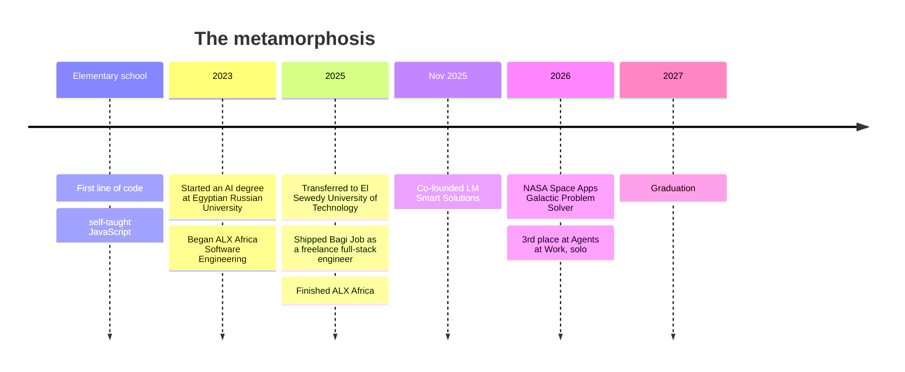

<!-- Header banner -->

  

  

  
  
  

  
  
  

---

## 🥚 → 🐛 → 🦋  My story

> I wrote my first line of code in elementary school, teaching myself JavaScript when it wasn't even a subject. I've been metamorphosing ever since.

---

## 🏆 Trophy shelf

<table>
  <tr>
    <td align="center" width="33%">🥉 <b>3rd place, solo</b> Agents at Work hackathon</td>
    <td align="center" width="33%">🚀 <b>Galactic Problem Solver</b> NASA Space Apps 2026</td>
    <td align="center" width="33%">🏅 <b>Best Squad</b> Banque Misr Data Governance program</td>
  </tr>
</table>

---

## 🔥 Featured work

| | Project | What it does | Try it |
| :-: | --- | --- | --- |
| 🛰️ | **FlameLens** | Wildfire detection, built for NASA Space Apps 2026 with team AstroSpark | [Live](https://flamelens-steel.vercel.app/) · [Case study](https://my-portfolio-mm2c.vercel.app/projects/flamelens) |
| 🤖 | **TalentScout AI × Lili** | An AI hiring agent that screens candidates, built on Wessam AI | [Live](https://lili-hr-agent.vercel.app) · [Case study](https://my-portfolio-mm2c.vercel.app/projects/talentscout-ai-lili) |
| 📅 | **LM Reservations** | A booking platform built at LM Smart Solutions | [Demo video](https://youtu.be/MUpSX5gP1y4) |
| 🦋 | **My portfolio** | React, TypeScript and Supabase, with a butterfly swarm and my own admin page | [Visit](https://my-portfolio-mm2c.vercel.app/) |

---

## 🛠️ Toolbox

   
   
  

<b>🧭 Choose your path: what are you here for?</b>

 

- **Hiring?** Start with [FlameLens](https://flamelens-steel.vercel.app/) and [Lili](https://lili-hr-agent.vercel.app), my two most complete products.
- **Want the full picture?** The [portfolio](https://my-portfolio-mm2c.vercel.app/) has every project, with the exact skills each one used.
- **Want to collaborate?** [Email me](mailto:laila.mohamed.fikry@gmail.com). I answer fast.

---

## 🎨 Beyond code

I paint, I travel, and I like adventure. The butterflies on my portfolio come from my art. I think the best engineering comes from people who make things for the joy of it.

---

## 📊 My GitHub, by the numbers

  

---

  <em>"The purpose of abstraction is not to be vague, but to create a new semantic level in which one can be absolutely precise."</em> 
  Edsger W. Dijkstra

  🦋 <b>Let's build something that matters.</b> <a href="mailto:laila.mohamed.fikry@gmail.com">Say hello</a>

